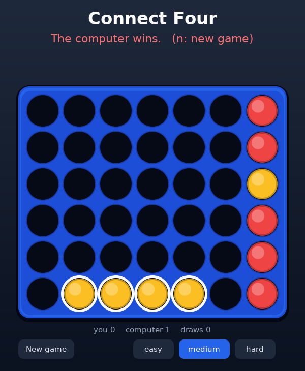

# Ak

[](https://github.com/notyourbusinessss/ai-codinglanguage-/actions/workflows/ci.yml)

A programming language designed for an LLM to write and read: **cheap in tokens, fast at runtime, able to do everything, and verified for correctness** — and now **self-hosted**: the compiler is written in Ak and emits native x86-64 Linux executables directly (own assembler, own ELF writer, own runtime and garbage collector; no libc, no linker, no C, no JavaScript at run time).

```
(= (fib n a=0 b=1) (? n==0 a (fib n-1 b a+b)))
(= (qs [p ..r]) (? p==nil [] [..(qs (~? x=>x<p r)) p ..(qs (~? x=>x>=p r))]))
(for [w n] (sort kv=>[-kv[1] kv[0]] c) (p w n))
```

It also draws its own windows: a pure-Ak **X11 client** (`lib/x11.ak`) and a software **canvas** with anti-aliased shapes and real fonts (`lib/canvas.ak`) — no GUI library, no browser (see [Connect Four in its own window](#programs-written-in-ak)).

Statements are S-expression forms; expressions are *tight infix chunks* (`fib(n-1)+fib(n-2)`, `t[i j]`, `x+=1`, `x=>x*2`, `a[1..]`, `#xs`). The whole language reference is one page: [`SPEC.md`](SPEC.md) (~1,870 tokens). Source files use the extension `.ak`.

## Quick start
```
./bin/ak prog.ak [args]          compile to memory and run (a 1.3 MB static binary; Linux x86-64)
./bin/ak build prog.ak out       write a native executable
./bin/ak -e '(p 1+2)'            run a snippet
./bin/ak check prog.ak           parse + resolve only      ./bin/ak fmt prog.ak    canonical source
./build.sh                       rebuild bin/ak from src/ with itself (iterates to a fixpoint)
./bin/ak examples/tictactoe.ak   a small game: tic-tac-toe against an unbeatable computer (build it into its own executable with `ak build`)
./bin/ak examples/connect4.ak    Connect Four in your terminal (arrow keys, colour, animation): uses the native terminal library, no libraries
./bin/ak examples/connect4web.ak Connect Four with a graphical UI in your browser (http://localhost:8080), served by the program itself: native sockets, no JavaScript
./bin/ak examples/connect4gui.ak Connect Four in its own native window: Ak speaks the X11 protocol itself (lib/x11.ak) and draws with its own canvas (lib/canvas.ak): no browser, no GUI library
```
`bin/ak` is the committed seed. Without it (or to re-derive everything from scratch) Node can bootstrap it once: `./build.sh --boot`.

## Programs written in Ak
Everything below is plain Ak, compiled by the native compiler, with no library underneath (`examples/`, `lib/`):

| program | what it shows |
|---|---|
| `tictactoe.ak` | a complete game against an unbeatable computer (minimax) in ~40 lines |
| `connect4.ak` | Connect Four in the terminal: raw mode, key decoding (arrows, Esc, UTF-8), ANSI colour, braille-dot discs, animation (`rt/term.ak`) |
| `connect4web.ak` | the same game with a browser UI, served by the program itself (poll-multiplexed HTTP server on native sockets) |
| `connect4gui.ak` | the same game in **its own window**: mouse and keyboard, falling-disc animation, level buttons, flashing win line; idle CPU is 0 |

The shared game logic (rules, alpha-beta computer player at three depths) is `examples/connect4/game.ak`; the three front ends only draw and read input.

 

How the window works: `lib/x11.ak` speaks the X11 core protocol itself over the display's Unix socket (authorization cookie from `~/.Xauthority`, window, events, `PutImage`/`GetImage`; ~170 lines) and `lib/canvas.ak` is a software renderer (BGRA canvas, anti-aliased discs/rings/rounded rectangles, alpha blending, masked blits, DejaVu text at 15/22/34 px; ~100 lines). API: [`SPEC-extra.md`](SPEC-extra.md) ("Windows and graphics").

## How self-hosting works
```
boot/ (JS) ──compiles──▶ src/main.ak ──▶ ak1 ──compiles──▶ src/main.ak ──▶ ak2 ──▶ ak3 …   ak1 == ak2 == ak3 (byte-identical)
```
- `src/` — the compiler, written in Ak: `parse.ak` (parser) → `lower.ak` (names, scopes, closures, tail calls → core IR) → `gen.ak` (x86-64 code generation) → `x86.ak` (assembler + ELF writer) · `fmt.ak` (formatter) · `main.ak` (CLI, tree shaking).
- `rt/` — the runtime, also Ak, compiled into every program: arithmetic with overflow checks, strings, lists, hash maps, `show`, exact float printing/parsing (bignum), regex, BigInt, typed arrays, JSON, math (fdlibm ports), file/process I/O, and the copying garbage collector (the copy loop is a hand-written assembly stub).
- `boot/` — the stage-0 bootstrap and the JS target (`ak.js`, `runtime.js`, `syntax.js`, …). It is only needed to build the very first compiler, and as an alternative backend with Node interop (`fs`, `fetch`, `async`).
- The runtime is compiled once into a **prebuilt image** (code + data + labels) baked into `bin/ak`; user programs are lowered and assembled against it, which is why compile+run of a small program takes ~7 ms. `ak build --image` produces such a compiler; `AK_NOIMAGE=1` forces the slow full path.
- Values are NaN-boxed doubles; Ak values live on a separate value stack (precise GC roots); closures are converted and boxed; general tail calls; exceptions are a handler chain. Programs report uncaught errors as `error: msg (file:line:col)`.

`tests/selfhost.js` checks the fixpoint (JS-built ak1 == native-built ak2 == ak3, also under GC stress, and seed→b2 == ak2).

## Results (all measured, all reproducible)

### Token cost — 24 realistic programs, same behaviour as the Python reference
| | Anthropic tokenizer | GPT o200k |
|---|---|---|
| Python | 3078 (100%) | 2948 (100%) |
| **Ak** | **2567 (83.4%)** | **2429 (82.4%)** |
| Ak v1 (my first design) | 3257 (106%) | 3354 (114%) |

The language reference ([`SPEC.md`](SPEC.md)) is 1,871 tokens. Real Ak code that was not tuned for tokens (the compiler, runtime, GUI library and games: 57 files, `src/ rt/ lib/ examples/ tests/native/`) is about 150,000 tokens. Re-measure with `node tools/measure.js py ak` (needs the tokenizer packages, see `tools/tok.js`).

My first version was actually *more* expensive than Python (the cryptic `~?` and `<@` heads cost more tokens than the words they replaced). The v2 design came from measuring: single-character heads fuse with the paren into one token while words and 2-char operators cost two; tight infix saves parens; compound assignment (`x+=1`: 3 tokens vs 7), multi-index (`t[i j]`), destructuring, truthiness (`(wh q ..)` vs `(wh (> (# q) 0) ..)`) and `fmt` removed most of the rest. See `tools/tok.js`, `tools/measure.js`.
*Caveat: counts use the `@anthropic-ai/tokenizer` package (a legacy Claude tokenizer) and GPT's o200k as proxies; a current Claude tokenizer may differ somewhat.*

### Speed
| benchmark | Ak native | Ak → JS (V8) | Python 3.13 |
|---|---|---|---|
| naive `fib(38)` | 0.41 s | 0.77 s | 5.0 s |
| sieve of 20M (`u8` array) | 0.37 s | 0.88 s | — |
| 500k string-key map inserts + lookups | 0.35 s | 0.62 s | — |
| compile the compiler (5.5k lines of Ak) | 0.30 s | — | — |
| compile + run hello world | 0.007 s | 0.07 s | — |

Integer-overflow checking (see below) is on in both; the JS target has `--fast` to skip it.

### Correctness
| check | |
|---|---|
| 24 corpus programs vs **independent Python reference outputs** (JS target) | 24/24 |
| 22 of them + 28 more native test programs (incl. a GC torture test): native executable vs JS backend, normal and under GC stress (a collection after every 1 KB allocated, heap verifier on; ~30,000 collections per run) | 50/50 identical |
| Terminal UI driven through a real pseudo-terminal (key decoding, raw-mode restore, the game) | 10/10 |
| GUI against a real X server (Xvfb) with real injected mouse/keyboard events (xdotool): pixels read back through a second X connection, window title, close, the game's moves and the computer's answer | 23/23 |
| Self-hosting fixpoint (JS-built = native-built = rebuilt, plain and GC-stress) | ✔ |
| Differential fuzzing (JS target): random programs vs a separate reference interpreter | 20,000 on the final build, 0 mismatches |
| Differential fuzzing (native executable vs the same reference interpreter, with a test-case shrinker; every program also run under GC stress) | 14,000+ programs, 0 mismatches (found: empty-string compare, list-put padding) |
| Parser written in Ak vs the JS parser | 492 files identical · assembler vs GNU `as`: 2,000+ encodings identical |
| Float formatting/parsing vs V8: 20,000 random doubles round-trip | 0 mismatches · `exp log sin cos tan atan asin acos sinh cosh tanh cbrt log2 log10`: 0 mismatches / 3,700 random inputs |

The fuzzer found real bugs I would not have written tests for: a spread operand aliasing a later mutation, silent `NaN` from an unchecked fast path, left-operand type checks running before right-operand side effects, falsy default parameters (`b=0`) being dropped, and a `!!x` parse error.

## Design decisions (and why)
- **Python truthiness** (`false nil 0 "" [] {}` falsy) + **`??`** for nil-only defaults (`m[k]??0`) — the `||`-eats-zero trap bit one of the first corpus programs.
- **`=` is function-local like Python**, never silently clobbers an outer variable; `x+=1` on an outer variable is a *compile error with a hint* (`(<- x x+1)`).
- **No silent coercion**: `nil+1`, `"a"-1`, `nil<1` throw (`null<1` is `true` in JS). Bools count as 0/1.
- **Integers exact to 2^53; beyond that `+ - * **` throw** `integer overflow` (use BigInt `10n`).
- Chained comparisons evaluate each operand once with exact short-circuit (`0<=f(x)<n`).
- Python's operator precedence (not C's: `n&n-1==0` means what you think).
- Compile-time checks: undefined names, arity of direct calls, rest/pattern misuse, misplaced spreads, dangling infix operators — all as `file:line:col: message`.

## Layout
`src/` compiler · `rt/` runtime · `bin/ak` seed binary · `boot/` JS bootstrap + JS target · `lib/` libraries written in Ak for programs (`x11.ak`, `canvas.ak`, embedded fonts) · `tests/` · `corpus/` (24 programs: `.py` reference, `.out` expected) · `examples/` · `docs/` (screenshots) · `tools/` (token meter, v1→v2 migrator, font-atlas generator) · `build.sh`.

## Testing
GitHub Actions (`.github/workflows/ci.yml`) runs `npm test` on every push and pull request, and checks that the committed `bin/ak` is exactly what `./build.sh --boot` produces from the sources (if you change `src/` or `rt/`, run `./build.sh` and commit the new `bin/ak`).

`npm test` runs everything (JS-target suites, differential fuzzer, parser/assembler diffs, self-hosting fixpoint, native-vs-JS comparison, native fuzz, the terminal test, the GUI test). The terminal test needs `python3`; the GUI test needs `Xvfb` and `xdotool` (CI installs them) and is skipped with a message when they are missing. `node tests/selfhost.js`, `node tests/native_diff.js` and `node tests/fuzz_native.js COUNT SEED` are the native-specific ones.

## Known limits
- Native target only runs on x86-64 Linux; strings are UTF-8 bytes (`#"é"` is 2; the JS target counts UTF-16 units).
- Native target has no async/Promises, `req`, `js`, `new`, or Node modules; use the JS target (`node boot/ak.js`) for `fetch`, npm packages, async servers. Natively there are blocking TCP sockets plus `fdwait` (poll) — enough to write an HTTP server in Ak itself (`examples/httpd.ak`) — but no TLS or DNS.
- `**`/`pow` with fractional exponents can differ from V8 in the last digit (~3% of random inputs); `sin cos tan` of arguments beyond ~1e6 (exact bignum reduction) can be off by one digit in ~1% of cases.
- The GUI library targets Linux with X11 or XWayland: depth-24 displays, fixed-size windows, ASCII text, no clipboard or window resizing yet. The terminal library needs a Linux terminal (raw mode via `ioctl`).
- No static types. Overflow-checked arithmetic is a few times slower than unchecked in arithmetic-bound loops.
